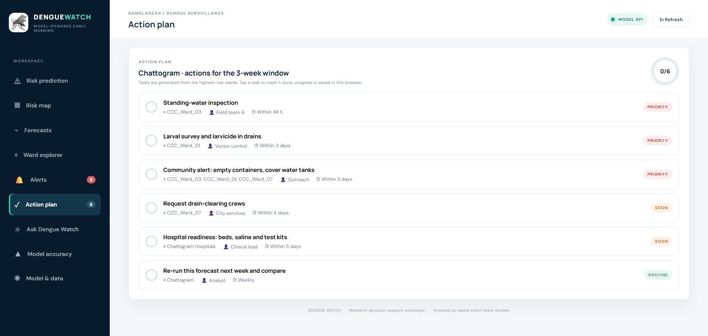

# Dengue Watch

**Ward-level dengue forecasting and early-warning dashboard for Bangladesh.**

[Live demo](https://dengue-watcher.onrender.com) · [Architecture](ARCHITECTURE.md) · [Project plan](plan.md)

Dengue Watch predicts weekly dengue cases for **60 wards in 5 cities** (Dhaka North, Dhaka South, Chattogram, Gazipur, Narayanganj), **0 to 12 weeks ahead**, plus a seasonal outlook for 2026 and 2027. Forecasts become risk bands (Low / Medium / High / Critical), ranked wards, alerts, an action plan and a bilingual (English and Bangla) assistant.

> **Note:** Research prototype built on the supplied dataset. Not an official public-health alert.

## Screenshots

Click any image to see it full size.

<table>
<tr>
<td width="33%"><a href="docs/screenshots/risk-map.png"></a><br><sub>Risk map</sub></td>
<td width="33%"><a href="docs/screenshots/risk-prediction.png"></a><br><sub>Risk prediction</sub></td>
<td width="33%"><a href="docs/screenshots/model-accuracy.png"></a><br><sub>Model accuracy</sub></td>
</tr>
<tr>
<td width="33%"><a href="docs/screenshots/forecasts.png"></a><br><sub>Forecasts</sub></td>
<td width="33%"><a href="docs/screenshots/ward-explorer.png"></a><br><sub>Ward explorer</sub></td>
<td width="33%"><a href="docs/screenshots/alerts.png"></a><br><sub>Alerts</sub></td>
</tr>
<tr>
<td width="33%"><a href="docs/screenshots/action-plan.png"></a><br><sub>Action plan</sub></td>
<td width="33%"><a href="docs/screenshots/ask-dengue-watch.png"></a><br><sub>Ask Dengue Watch</sub></td>
<td width="33%"><a href="docs/screenshots/model-and-data.png"></a><br><sub>Model and data</sub></td>
</tr>
</table>

<sub>The risk map is schematic, not geographic (the dataset has no coordinates). Forecasts and Ward explorer use the last data week (29 Dec 2025), which is off-season, so values are near zero.</sub>

## Contents

[Quick start](#quick-start) · [Features](#features) · [Data](#data) · [Method](#method) · [Results](#results) · [Findings](#findings) · [Limitations](#limitations) · [Roadmap](#roadmap) · [Project structure](#project-structure) · [Tech and AI use](#tech-stack-and-ai-use)

## Quick start

Requires Python 3.10+. The saved models need **scikit-learn 1.9.1** (pinned in `requirements.txt`).

```bash
git clone https://github.com/Syed-Md-Abdud-Dayan/Solarix.git
cd Solarix
python -m venv .venv
source .venv/bin/activate        # Windows PowerShell: .venv\Scripts\Activate.ps1
pip install -r requirements.txt
pip install -e .
python app.py
```

Open <http://127.0.0.1:5000> (long-range forecast: `/future.html`). No Node.js or build step.

| Task | Command |
|---|---|
| Run tests | `pip install -r requirements-dev.txt && python -m pytest tests -q` |
| Check the API | `python verify_api.py` |
| Retrain models | `python scripts/train_dengue.py` |
| Export 2026–2027 forecast CSV | `python scripts/forecast_future.py --end 2027-12-31` |
| Re-run long-range back-test | `python scripts/backtest_future.py` |

**API:** `/api/health` · `/api/dashboard` · `/api/risk` · `/api/map` · `/api/ward/<id>` · `/api/future` · `/api/chat/suggestions` · `POST /api/chat`

## Features

| Feature | What it does |
|---|---|
| Forecasts | Expected cases per ward-week, 0 to 12 weeks ahead, plus 2026–2027 outlook with 80% range |
| Risk map and ranking | Low / Medium / High / Critical bands, wards ranked by risk |
| Alerts and action plan | Shows which wards need inspection and clean-up first |
| Ward explorer | History, forecast, drivers and what-if sliders per ward |
| Model accuracy | Held-out test results, outbreak precision / recall / F1 |
| Ask Dengue Watch | Rule-based English and Bangla assistant, no external AI service |

## Data

| Item | Value |
|---|---|
| Records | 31,320 weekly ward rows (60 wards × 522 weeks, no gaps) |
| Period | 2016-01-04 to 2025-12-29 |
| Total cases | 82,572 (58% of rows are zero) |
| Weather | Temperature (avg / max / min), rainfall, humidity |
| Ward profile | Population density, sanitation score, water-logging index |

## Method

- **Features (37 to 45 per ward-week):** weather lags and rolling sums/means, ward case history (horizons 1–12 only; horizon 0 is a weather-only nowcast), ward profile, city flags, sine/cosine of week of year.
- **No leakage:** every time-varying input is shifted back by the forecast horizon.
- **Models:** one per horizon (13 total). Candidates: Poisson GLM, Random Forest (200 trees), tuned Gradient Boosting (Poisson loss), and a 50/50 GB + RF ensemble. Baselines: seasonal average and persistence. Selection uses lowest Poisson deviance.
- **Validation:** train 2016–2022, test 2023–2025 (9,420 ward-weeks). Tuning uses expanding-window CV on earlier years only. Peak-season error is reported separately.
- **Deployment:** the deployed Gradient Boosting models are refit on all years. Serving rebuilds features from the last 30 weeks, with no training at request time.
- **Long-range forecast (beyond 12 weeks):** the weather-only model runs on each past year's weather as a possible future, giving an expected value and 80% range per ward and week.

More diagrams in [ARCHITECTURE.md](ARCHITECTURE.md).

## Results

Test years 2023–2025. MAE is cases per ward per week.

| Horizon | MAE | R² | Outbreak AUC | Seasonal-average MAE |
|---|---:|---:|---:|---:|
| Nowcast (weather only) | 0.87 | 0.85 | 0.98 | n/a |
| 3 weeks | 1.10 | 0.77 | 0.96 | 1.36 |
| 12 weeks | 1.35 | 0.64 | 0.93 | 1.36 |

**Outbreak alarms** (≥10 cases in a ward-week; 869 events), 3 weeks ahead: precision **67.9%**, recall **55.7%**, F1 **61.2%**.

**Blind test of the 2026+ method** (train before a year, forecast the full year):

| Measure | Result |
|---|---|
| Ward-week R² | 0.64 (seasonal average 0.62) |
| Yearly total error 2023 / 2024 / 2025 | −16% / +26% / +12% |
| Peak-week timing | off by 3 to 8 weeks |
| 80% range covers outcome (city-week) | 83% to 88% |

## Findings

- Weather, season and ward profile give a good short-range forecast (nowcast R² 0.85).
- Rainfall leads cases by about 3 weeks (correlation 0.75); high water-logging wards have far more cases (0.82); cases peak in August and September.
- At 0 to 4 weeks the models clearly beat both baselines. By 12 weeks they equal the seasonal average (MAE 1.35 vs 1.36).
- Errors in June to October are about twice the all-year average.
- The long-range forecast says *when* in the season and *which wards* are worse, not the exact week or size of a given year's outbreak.

## Limitations

- The dataset may be partly or wholly simulated (no missing values, fixed ward profiles, very regular seasonality). Results are not validated against real surveillance data.
- No coordinates, populations or boundaries: the map is schematic and incidence per 100,000 cannot be computed.
- Feature importance and what-if sliders show association, not cause.
- Deployed models are refit on all years, so back-testing a date inside 2016–2025 looks better than the held-out results.
- 2026 and 2027 forecasts are almost identical by design.
- Gazipur and Narayanganj have only 5 wards each. Risk bands are fixed cut-offs, not calibrated probabilities.

## Roadmap

- Live case reports and weather forecasts
- Real ward boundaries and populations (geographic map, incidence rates)
- Best model per horizon (gradient boosting is used for all now)
- Per-ward SHAP explanations and calibrated outbreak probabilities
- Scheduled retraining, monitoring, SMS / email alerts

## Project structure

```
app.py                  API and web server
data/                   Source dataset
src/dengue_watch/       Features, models, long-range forecast, chatbot, knowledge base
scripts/                Training, forecast export, back-test
artifacts/              Saved models, test predictions, metrics
web/                    Dashboard (HTML, JavaScript, CSS)
tests/                  Chatbot tests
docs/screenshots/       Images used in this README
```

## Tech stack and AI use

**Stack:** Python, pandas, NumPy, scikit-learn 1.9.1, joblib, pytest. Standard-library HTTP server backend; plain HTML, CSS, JavaScript and SVG frontend. Hosted on Render.

**AI in the product:** forecasting uses classical machine learning, not language models. The assistant is rule-based and gives general health information, not diagnosis. Hotline numbers and medical text should be clinician-reviewed before public use.

**AI in development:** Claude (Anthropic) assisted with planning, review and documentation. All reported results come from the project's own pipeline and artifacts; the team reviewed the output and is responsible for the final project.
